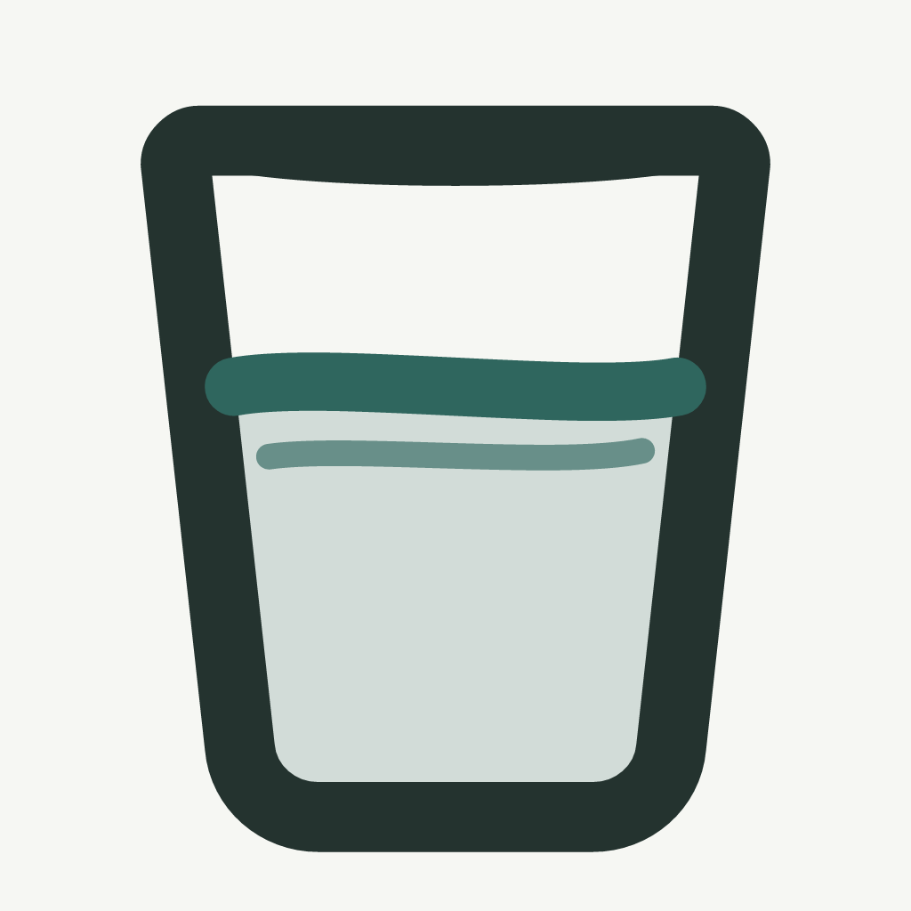

# 记得 · 轻量喝水提醒



按自己的作息安排好，iPhone 就会提醒你喝口水。瓷白与深湖青主题、轻柔提示音、离线本地通知，无需注册账号，也不必每天打开 App。

## iPhone 下载与安装

**当前提供源码测试版，尚未开放 TestFlight 或 App Store 安装。**

- **有 Mac：**[下载 iPhone 测试工程 ZIP](https://github.com/st2980929-ops/jide-water-reminder/releases/download/v0.3.2-preview.1/Jide-iPhone-test-project-v0.3.2.zip)，解压后按[完整安装教程](安装到iPhone.md)，用 Xcode 和自己的 Apple 账户装到 iPhone。
- **没有 Mac：**目前没有面向普通用户的一键安装入口；后续 TestFlight / App Store 开放后会在这里更新链接。
- **开发者：**克隆本仓库后先执行 `npm ci`、`npm run ios:sync`，再打开 `ios/App/App.xcodeproj`。

Releases 附件中的测试工程已附带前端构建资源；GitHub 自动生成的 **Source code (zip)** 需要自行执行前端构建。测试工程 ZIP 不能直接在 iPhone 上安装，使用免费的 Personal Team 签名通常每 7 天需要重新覆盖安装。[查看发布页](https://github.com/st2980929-ops/jide-water-reminder/releases/tag/v0.3.2-preview.1)

**当前版本：0.3.2（构建 8，通知标题更新）。** 已安装用户在同一工程中重新按 ⌘R 覆盖更新，不要先删除手机上的 App。

**第一次安装：请先读 [安装到 iPhone](安装到iPhone.md)。** 本项目无需 Gemini API Key；请使用自己的 Apple 账户签名，测试工程不包含作者的证书或签名团队配置。

## 目前具备的功能

- 每天、每周自选工作日、指定日期三种提醒安排。
- 起止时间、30/45/60/90/120 分钟间隔、休息时段、跨午夜安排。
- 六种提示音：清泉水琴、晨雨露滴、静谧铜磬、晨光微弦、陶杯轻触、木纹回响。一个选择框、一个试听按钮、一个 0–100% 基础音量滑轨；0% 只显示通知，不播放提示音。
- 首页仅保留「喝了一杯」和设置入口；日程、声音、提醒开关与外观集中在设置。
- 水杯上方每天显示一句健康小知识，14 条按手机本地日期轮换，同日固定、离线可用；来源与内容见 [HEALTH_TIPS.md](HEALTH_TIPS.md)。
- 真实系统通知授权、10 秒后测试所选提示音/系统默认音、查看系统中的下次提醒。
- 长按正式提醒通知，使用「稍后提醒」「暂停提醒」。暂停后可在静默确认通知中恢复，也可以回 App 恢复。
- 可选的「喝了一杯」记录和跟随系统/深浅色外观。杯数记录不影响通知，不必每天打卡。
- 修改声音或日程会保留暂停状态。退出未保存的修改会返回设置。
- 桌面图标保持静态；动态桌面图标和小组件暂时搁置。
- 没有账号、服务器或分析埋点。提醒设置保存在本机，不需要日历权限。

## 必须了解的边界

1. 每天/工作日使用 iOS 重复日历触发器，不依赖每天打开 App，也没有在后台轮询。指定日期使用一次性触发器，全部结束后需要选择新日期。
2. iOS 待发本地通知有数量限制。本版最多保存 62 条日程规则，另外留出测试和稍后提醒的位置。重复规则可以持续运行；这里的 62 不是只能提醒 62 次。超额安排会阻止保存并说明原因。举例：周一至周五、09:00–18:00、午休 12:00–13:30、每 60 分钟需要 40 条规则；同样时段每 30 分钟需要 75 条，需缩短时段或增加间隔。选一周七天会合并为每天规则，减少占用。
3. 「暂停提醒」持续到你手动恢复。此版不承诺“明天自动恢复”。暂停状态不会只靠页面变量维持。
4. 「稍后提醒」保留原日程，补一条约 10 分钟后的提醒；如果原日程在 10 分钟内就有下一条，会直接使用它，避免连续重复。用户主动选择的稍后提醒可能超出原时段。
5. 基础音量滑轨改变通知音频文件自身的幅度，不修改手机系统音量。通知仍遵守「铃声和提醒」、静音、专注模式和通知摘要设置。App 内试听使用媒体音量，实际效果请用测试通知检查。
6. 当前 90 项自动检查、Swift 模型/触发器/PCM 音量检查、资源检查与 iOS Release 编译通过。手机宽度下检查了声音选择和滑轨操作。真实手机上的通知听感及“测试后再试听”仍需按实际场景复验。

## 声音与音量

进入「设置 → 声音与通知」，选中声音后点「试听」。拖动「提示音基础音量」，确认后点「保存声音」。0% 会关闭提示音，但保留通知。旧柔和选择对应 65%，旧清晰选择对应 100%；覆盖安装不要求重新设置日程。

空灵竹韵、短风铃、溪涧缓流、岸边微浪、林间轻风、叶间鸟语已从菜单移除。旧安排若选中这些声音，会在打开 App 时尝试迁移到清泉水琴，并保留时段和暂停状态；迁移失败会提示重新保存。原音频暂留在安装包用于升级前已排队通知的兼容，不再作为可选音色。

iPhone 内试听通过原生播放器播放与通知相同的 WAV；网页布局预览保留 Web Audio 试听。播放器遇到系统中断后会释放，下一次点击会重新创建；失败会显示提示。

## 提示音太轻时

提高基础音量后，先点「测试所选提示音」。等待 10 秒，可以锁屏，也可以回到正在播放的视频中听。测试不改变正式安排；确认喜欢的音量后点「保存声音」。试听使用媒体音量，实际通知使用系统提醒音量，两者听起来可能不同。

若仍明显偏轻，可与「通知没有声音？」中的系统默认音在同一场景比较。iPhone 的「注视感知功能」可能在你看着屏幕时调低提醒音量，这不是已确认的故障原因。[Apple 说明](https://support.apple.com/zh-cn/102216)

排查区显示系统声音授权、正式提醒已保存的提示音和音频文件是否存在；这些状态不能证明某次提醒最终以多大音量播放。桌面动态图标与小组件继续搁置。

## 开发与更新

需要 Node.js 22.12 或更新版本。终端进入项目根目录后：

```sh
npm ci
npm run dev
```

网页只用于预览布局和声音，不会假装获得 iOS 通知授权。不要把网页“添加到主屏幕”当成这个原生提醒 App 的替代品。

更新前端并同步到 Xcode：

```sh
npm run lint
npm test
npm run test:native
npm run ios:sync
npm run verify:ios
npm run ios:open
```

重新导出声音或图标（已经预先生成，普通安装无需执行）：

```sh
npm run sounds:render
npm run icon:render
npm run ios:sync
```

## 目录

- `src/App.tsx`：实际安装版的设置与首页。
- `src/native/plan.ts`：把时段编译成可由 iOS 保存的日历通知规则。
- `native/`：Swift 通知调度器、Capacitor 插件、隐私清单和提示音。
- `ios/App/App.xcodeproj`：直接用 Xcode 打开的工程，依赖通过 Swift Package Manager 下载。
- `ios/App/App/public/`：随交付附带的静态页面与资源；运行 `ios:sync` 可重新生成。
- `src/components/logo/`、`design-system/`、`phone/` 和评审组件：保留的原始设计素材与参考组件；安装版入口不加载评审工作台。
- `tests/`、`scripts/`：日程测试、导出与资源完整性检查。

架构与验证记录见 [IMPLEMENTATION.md](IMPLEMENTATION.md)。

## App Store 上架准备

已命名为「记得」，首发以中国大陆为主。账户、备案适用性、隐私支持页面、商店素材与发行验证清单见 [APP_STORE_PREP.md](APP_STORE_PREP.md)，商店文案草稿见 [APP_STORE_COPY.md](APP_STORE_COPY.md)。当前还未提交审核。
